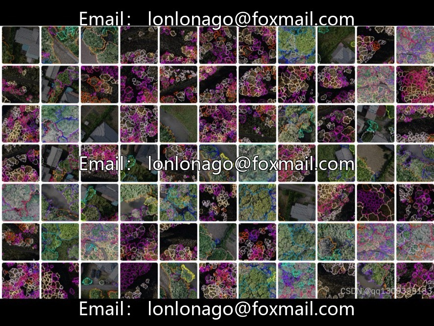
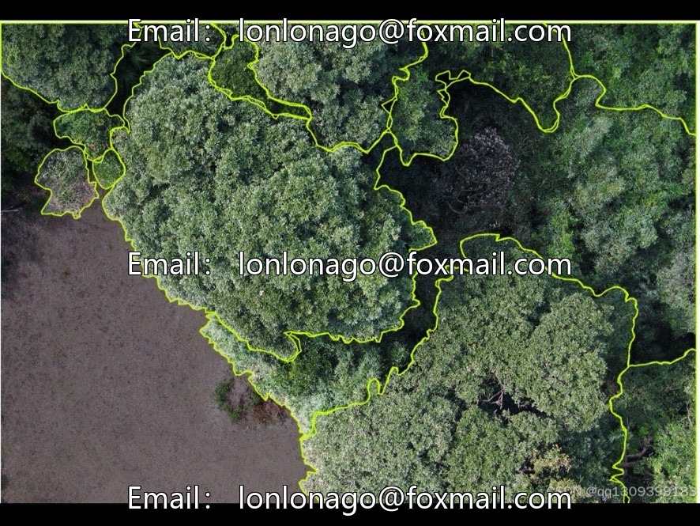
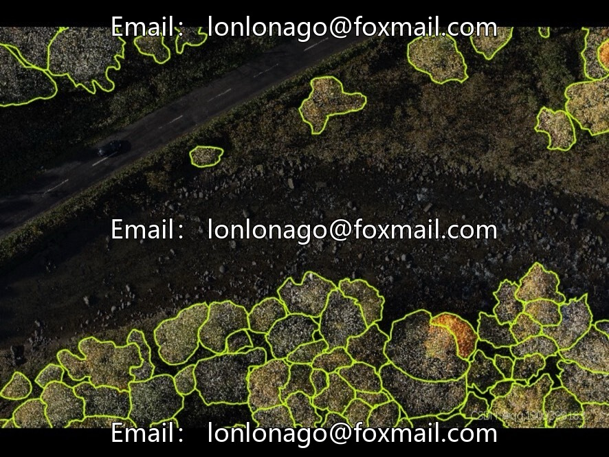
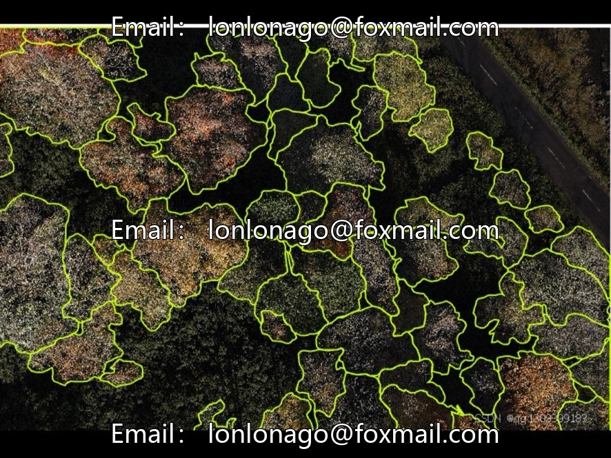
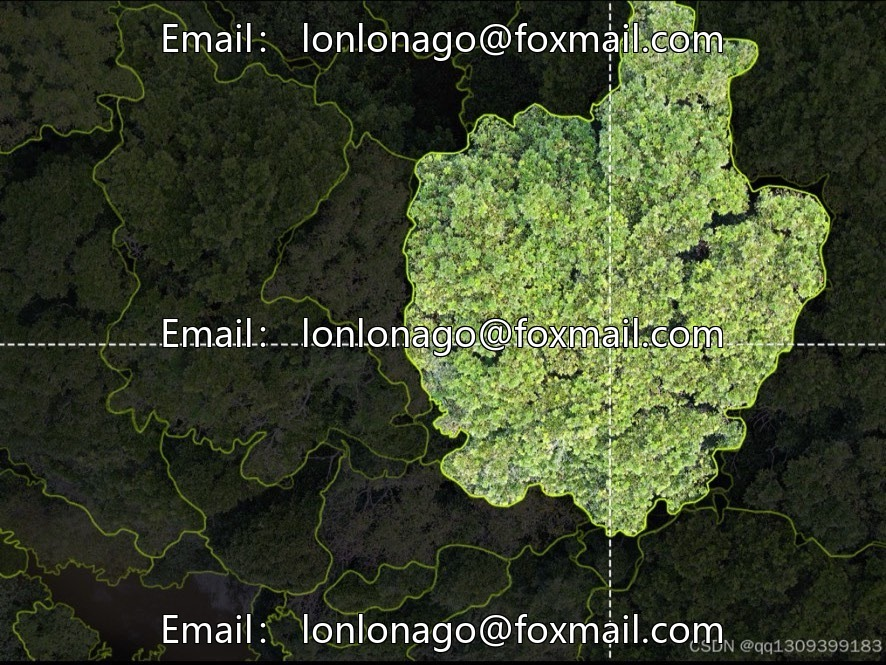
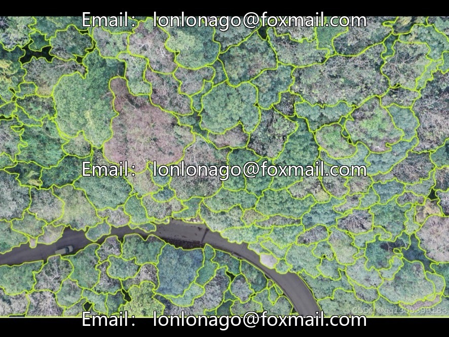

# Aerial Photo-Remote Sensing Canopy Segmentation Dataset | Issue 10057

## Body

Aerial Photo-Remote Sensing Canopy Segmentation Dataset | Issue 10057
Targeted for forestry cutting remote sensing monitoring, adapts to drone and satellite remote sensing imagery tree segmentation algorithm training.

I. Basic Overview
A total of 961 remote sensing images, covering multi-seasonal and different levels of logging in forested areas, integrated with satellite and aerial photography sources. Medium volume, supports training of instance segmentation models and ecological monitoring research.

II. Four Major Labeling Categories (Pixel-Level Masking)
1. Forest Area: All types of forests, complete canopy cover areas
2. Logging Area: Full and partial logging plots
3. Transition Area: Vegetation degradation belt at the border between forests and barren land
4. Non-Forest Interference: Roads, buildings, and other human-made lands, analyzing the causes of logging

III. Dataset Splitting Rules
No official fixed split, industry-wide: 70%-80% for training set, 20%-30% for test set, an additional 10% for validation set to tune parameters; the splitting should balance spatial distribution and avoid regional sample bias.

IV. Image Resolution Features
Multi-scale Mixed Images: High-resolution UAV images (identifying individual tree crowns) at 1–5 meters, medium-low resolution satellite images (large-scale macro monitoring) at 10–30 meters; the images have undergone radiation and geometric correction preprocessing, coordinate unification, facilitating temporal comparison.

V. Core Application Scenarios
1. Ecological and Environmental Protection Supervision: Automatically identify illegal logging patches, measure the area of forest destruction, and provide enforcement data.
2. Forestry Resource Management: Statistics of forest land stock, assess vegetation recovery after logging, fire, and pests.
3. Climate Carbon Sequestration Studies: Quantifying Forest Carbon Stock Changes, Providing Surface Splitting Parameters for Climate Models
4. Land Planning: Differentiate between deforestation and agricultural expansion, urban construction expansion, to assist in land use control.
5. Algorithm Research: Used for evaluation of instance segmentation models such as Mask R-CNN, SegFormer etc.

Virtual materials, once sold, are non-refundable.
Interested friends, click "I want" to proceed.

## Images

## Payment

Here is a pay link on Stripe ( https://buy.stripe.com/3cs8yP7sY87d0vu9AB ). Please contact me lonlonago@foxmail.com after funding $89, and I will send you a complete data files , thank you!

